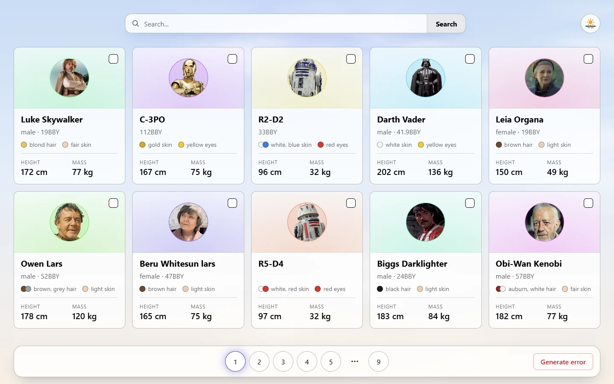
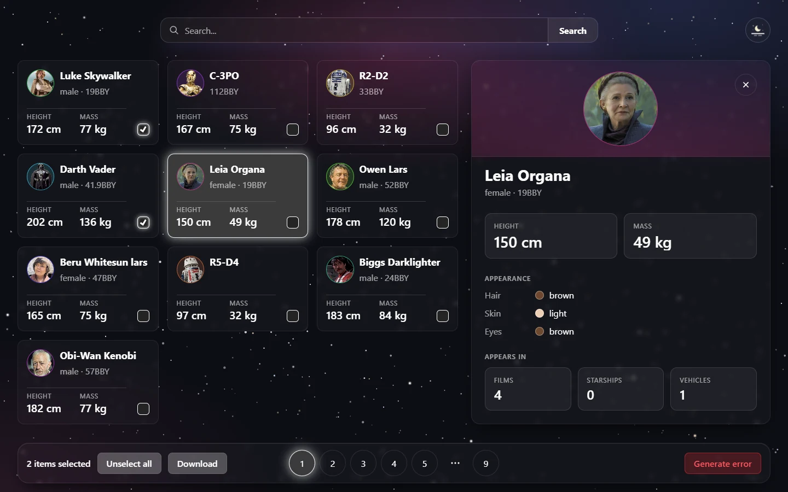

# Star Wars — character explorer

[](https://github.com/Krsisabi/star-wars/actions/workflows/ci.yml)

A single-page app for browsing Star Wars characters from [SWAPI](https://swapi.dev):
search, pagination, a details panel, multi-select with CSV export, and a light/dark theme.

**Live demo:** https://star-wars-krsisabi.vercel.app

| The list, light theme                                                | A character and the selection bar, dark theme                                                                          |
| -------------------------------------------------------------------- | ---------------------------------------------------------------------------------------------------------------------- |
|  |  |

## Features

- **Search** by character name, with the query kept in the URL and restored from local storage
- **Pagination** with sibling/ellipsis logic, also reflected in the URL — any page is a shareable link
- **Details panel** opened as a nested route (`/details/:id`), closes on a click outside or Escape
- **Multi-select** across pages, with a flyout showing the current selection
- **CSV export** of the selected characters, built with native browser APIs only (`Blob`, `URL.createObjectURL`) — no third-party packages
- **Light/dark theme** via Context API, persisted between visits
- **Error boundary** with a fallback screen

## Requirements

The app was built to a written brief with fixed acceptance criteria: the tasks of the
[RS School React course](https://github.com/rolling-scopes-school/tasks/tree/master/react).
Much of what shaped the code is in what the brief ruled out.

- **No component libraries.** Every control here (the cards, the pagination, the flyout, the
  theme switch) is written from scratch in SCSS modules.
- **No package for the CSV download.** `Blob`, `URL.createObjectURL` and `a.download` only, and
  the file name carries the number of selected rows.
- **No `any`, no `@ts-ignore`, no `.js` sources.** `tsc -b` runs in CI and on every Vercel build.
- **No direct DOM manipulation inside components**, apart from setting the theme attribute on
  `document.documentElement` in an effect.
- **Statement coverage at 80% or above**, currently 86% across 84 tests.

And in what it asked of the behaviour: the selection survives navigation between pages and
routes, the URL always reflects the current page and the open character, and the details panel
is a nested route rendered through `<Outlet>`.

## Stack

React 18 · TypeScript · Vite 6 · Redux Toolkit + RTK Query · React Router 7 · SCSS Modules · Vitest + Testing Library · ESLint 9 (flat config) + Prettier · Husky

## Getting started

```bash
npm install
npm run dev        # dev server
npm run build      # type-check and production build
npm run test       # unit and integration tests
npm run coverage   # tests with a coverage report
npm run lint       # eslint
```

## Project structure

```
src/
  App.tsx           routes; routes.ts holds their paths
  AppProviders.tsx  error boundary, theme and store, shared by the app and its tests
  components/       components with their styles and tests: shared ones (Button, Icon,
                    Avatar, StatusPage) and the parts of the page (List, Details, ...)
  pages/            route-level screens: Home, NotFound, ErrorPage
  store/            store factory, RTK Query API slice, selection slice
  hooks/            typed redux hooks, the search in the address, links that keep it,
                    closing the details panel, the theme
  context/          theme context and provider
  utils/            plain functions: character facts, pagination, CSV, storage
  styles/           global styles, the sky, shared Sass mixins
  data/, assets/    portrait links and the sky's pictures, made by scripts/
  test/             test setup, a render helper with a router and a store, mock data
scripts/            generators for src/data and src/assets
```

Data fetching and caching go through RTK Query; the selected characters live in a
regular slice, so selection survives navigation between pages and routes. Every
test gets a store of its own from the same factory the app uses.

## Engineering notes

After the course the app was read end to end as if it were someone else's code, and each fix
went in as its own commit. The ones worth naming:

- The details panel printed the character's **name** in the "skin color" row, one wrong field
  in the JSX.
- A failed request left the panel on _Loading..._ forever: the loading branch was tested before
  the error branch, so the error state was unreachable.
- The CSV export existed as a component but was never rendered, so the flyout had no Download
  button.
- The search query and the page number lived in component state, so a shared or reloaded link
  lost both. They moved into the address.
- The list keyed rows by character name instead of id, and the pagination rendered its links
  outside the `<li>` elements.
- A local-storage value that was not valid JSON threw on read instead of falling back to the
  default.

The rest of the work was structural: one `Button`, `Icon` and `Avatar` instead of near-copies,
one place each for routes, the store, the theme and storage, a single render helper behind the
tests, and a build that fails on the Sass deprecation it used to warn about. There are no
comments in the source: names and tests carry what they used to.

## Branches

`main` is the app. The other branches are the stages it was built in, each closed and
reviewed before the next one started, and kept as a record of how it grew:

| Branch                 | Stage                                                                 |
| ---------------------- | --------------------------------------------------------------------- |
| `class-components`     | first version on class components, error boundary                     |
| `hooks-and-routing`    | rewritten with hooks, routing and the details panel                   |
| `app-state-management` | Redux Toolkit, RTK Query, selection, CSV export, theming              |
| `forms`                | separate app: controlled and uncontrolled forms, react-hook-form, yup |

`forms` stands apart from the three stages above: it is a different task with its own root
commit, so it shares no history with `main` and is deployed separately.
